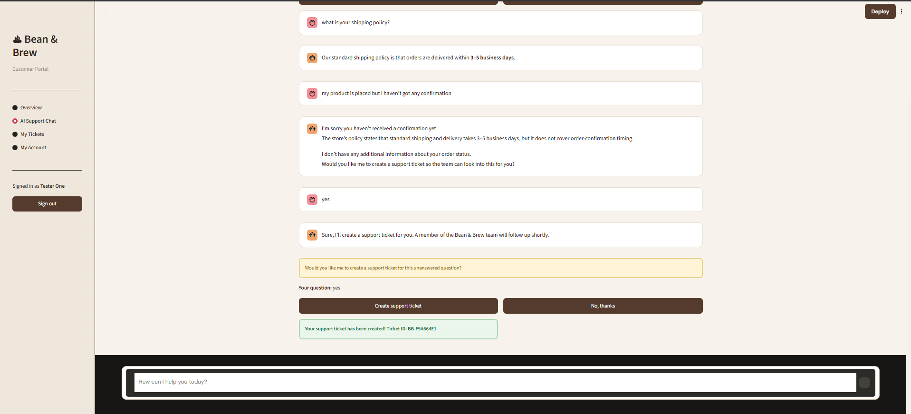
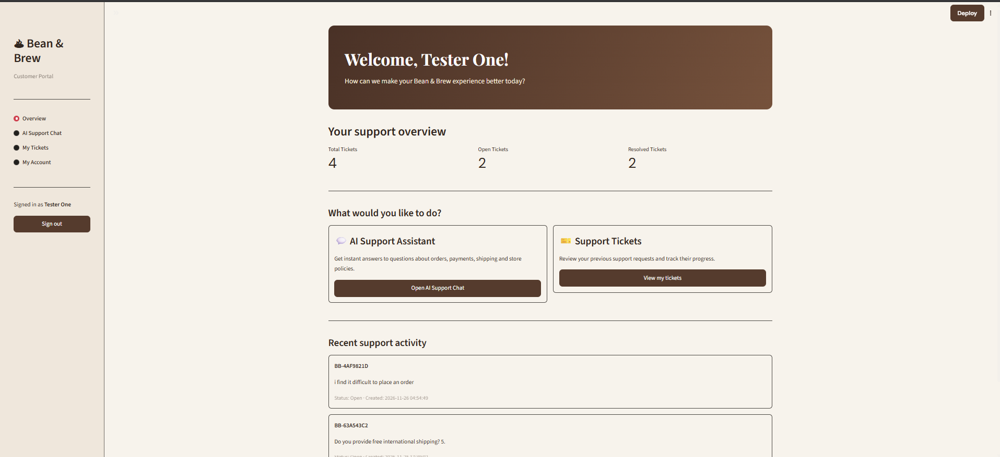
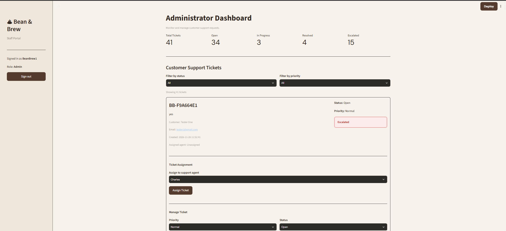
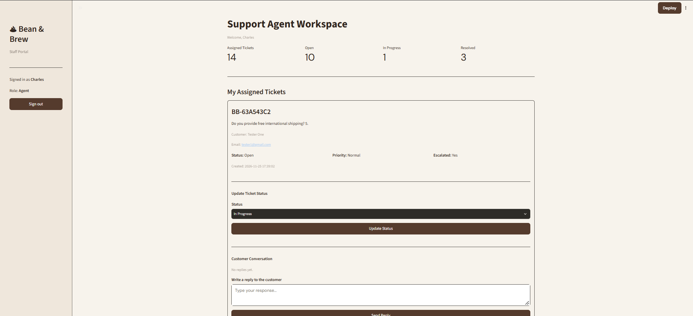

# Bean & Brew – AI Helpdesk Agent

An AI-powered customer support platform for a fictional online coffee store, built with **Python, Streamlit, Retrieval-Augmented Generation (RAG), Groq, ChromaDB, and SQLite**.

The application combines an AI customer-support assistant with customer account management, support ticket workflows, and dedicated staff dashboards.

## Features

### AI Customer Support
- Retrieval-Augmented Generation (RAG) for knowledge-grounded responses.
- Hybrid information retrieval combining BM25 keyword search and semantic search.
- Reciprocal Rank Fusion (RRF) to combine retrieval results.
- Context-aware follow-up question handling.
- Product catalogue and store-policy knowledge base.
- Source-document tracking for retrieved information.
- Groq-powered response generation.

### Customer Portal
- Customer registration and authentication.
- Dedicated customer dashboard.
- AI-powered support chat.
- Persistent conversation history.
- Support ticket creation and tracking.

### Staff Portal
- Separate staff authentication.
- Administrator and support-agent roles.
- Staff dashboard for ticket management.
- Agent-specific ticket access and assignment controls.
- Ticket status management.
- Restrictions preventing agents from modifying tickets assigned to other agents.
- Resolved tickets cannot be reopened through the normal workflow.

### Data and Security
- SQLite database for application data.
- Password hashing using bcrypt.
- Customer and staff authentication kept separate.
- Customer-level ticket access restrictions.
- Persistent ChromaDB vector storage.

## Technology Stack

| Component | Technology |
|---|---|
| Programming language | Python 3.13.3 |
| Frontend | Streamlit |
| LLM response generation | Groq |
| Additional LLM integration | Google Gemini SDK |
| Embedding model | Sentence Transformers – all-MiniLM-L6-v2 |
| Vector database | ChromaDB |
| Keyword retrieval | BM25 |
| Retrieval fusion | Reciprocal Rank Fusion |
| Application database | SQLite |
| Password security | bcrypt |
| Environment configuration | python-dotenv |

## System Architecture

### RAG Pipeline

The knowledge base is processed through the following stages:

1. **Document Loading:** Loads product and store-policy information.
2. **Text Splitting:** Divides documents into smaller chunks for retrieval.
3. **Embedding Generation:** Converts text chunks into semantic vectors using Sentence Transformers.
4. **Vector Storage:** Stores embeddings in ChromaDB.
5. **Hybrid Retrieval:** Combines BM25 keyword retrieval and semantic similarity search.
6. **Rank Fusion:** Uses Reciprocal Rank Fusion to combine retrieval results.
7. **Response Generation:** Supplies retrieved context to the Groq-powered LLM to generate responses.

### High-Level Architecture

```text
             Customer
                |
                v
         Streamlit Interface
                |
       +--------+---------+
       |                  |
       v                  v
  Customer Portal    Staff Portal
       |                  |
       v                  v
  AI Support Chat    Staff Dashboard
       |                  |
       v                  v
   RAG Pipeline       Ticket Management
       |
       v
  Hybrid Retrieval
   /           \
  BM25       Semantic Search
                |
             ChromaDB
                |
                v
        Retrieved Context
                |
                v
          Groq LLM
                |
                v
        AI Support Response

       SQLite Database
  (Users, Conversations, Tickets)
```

## Project Structure

```text
ai-helpdesk-agent/
│
├── app/
│   ├── auth.py
│   ├── chat.py
│   ├── dashboard.py
│   ├── staff_auth.py
│   ├── staff_dashboard.py
│   └── __init__.py
│
├── data/
│   └── knowledge_base/
│       ├── product_catalogue.txt
│       └── store_policy.txt
│
├── rag/
│   ├── document_loader.py
│   ├── embeddings.py
│   ├── rag_pipeline.py
│   ├── retriever.py
│   ├── text_splitter.py
│   └── vector_store.py
│
├── scripts/
│   ├── check_groq.py
│   └── list_gemini_models.py
│
├── tests/
│   ├── run_regression.py
│   ├── test_agent_security.py
│   ├── test_auth.py
│   ├── test_customer_data.py
│   ├── test_database.py
│   ├── test_embeddings.py
│   ├── test_loader.py
│   ├── test_rag_followups.py
│   ├── test_rag_responses.py
│   ├── test_retrieval_edge_cases.py
│   ├── test_retrieval_quality.py
│   └── ...
│
├── create_first_admin.py
├── create_staff_agent.py
├── database.py
├── llm.py
├── streamlit_app.py
├── chat_cli.py
├── requirements.txt
├── .env.example
└── .gitignore
```

## Installation and Setup

### 1. Clone the repository

```bash
git clone <YOUR_GITHUB_REPOSITORY_URL>
cd ai-helpdesk-agent
```

### 2. Create a virtual environment

```powershell
python -m venv .venv
```

Activate it on Windows:

```powershell
.venv\Scripts\Activate.ps1
```

### 3. Install dependencies

```powershell
pip install -r requirements.txt
```

### 4. Configure environment variables

Create a `.env` file in the project root using `.env.example` as a template.

```dotenv
GEMINI_API_KEY=your_gemini_api_key
GEMINI_MODEL=your_gemini_model_name
GEMINI_FALLBACK_MODELS=your_fallback_model_names
GROQ_API_KEY=your_groq_api_key
```

Add your own API credentials. Never commit `.env` or expose API keys publicly.

**Note:** The RAG pipeline currently uses Groq for response generation. Gemini is configured as an additional LLM integration.

### 5. Initialise the administrator account

Run:

```powershell
python create_first_admin.py
```

Follow the prompts to create the initial administrator account.

### 6. Create support-agent accounts

After initial setup, create additional support agents using:

```powershell
python create_staff_agent.py
```

### 7. Launch the application

```powershell
streamlit run streamlit_app.py
```

The application will open in your browser.

## Testing

The project includes tests covering:

- Retrieval quality.
- Retrieval edge cases.
- RAG response generation.
- Context-aware follow-up questions.
- Authentication and access control.
- Customer data isolation.
- Ticket operations.
- Embedding generation and document processing.

Run the RAG regression suite:

```powershell
python -m tests.run_regression
```

**Current RAG regression result:** 26/26 checks passed across four suites.

The regression runner covers the RAG-related suites; the other database and security scripts are separate checks.

## Current Development Status

The project has working customer and staff workflows, persistent application data, a hybrid RAG retrieval pipeline, and regression coverage for core RAG behaviour.

Further improvements can include:
- More comprehensive automated integration tests.
- Improved evaluation of retrieval relevance and answer quality.
- Expanded knowledge-base ingestion and document management.
- Production deployment with persistent database and vector storage.
- Monitoring, logging, and analytics for support operations.

## Project Objective

This project explores how Retrieval-Augmented Generation can be integrated into a practical customer-support workflow, combining semantic search, keyword retrieval, LLM-based responses, authentication, and role-based ticket management in a single application.

## Application Screenshots

### Customer Interface





### Staff Interface



